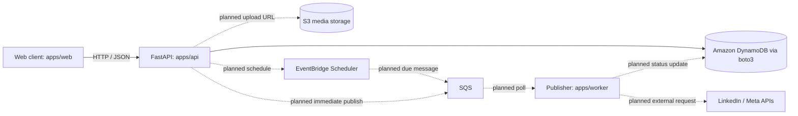

# Interaction-to-Database Flow Map

This document traces a user or system event from its entry point through functions, API calls, persistence, asynchronous work, and the resulting UI state. It is the file-to-file and function-to-function map for Chartes.Tech.

## Status and update rules

- **Implemented** means the path exists in the current repository and was confirmed from source.
- **Planned** means the path is specified by the PRD or intended design but is not implemented yet.
- Do not describe a planned function, endpoint, table, or queue as existing code. Link planned names to their intended owning module when known.
- Update this document whenever code changes add, remove, or alter an interaction path, API call, persistence operation, background task, or user-visible result.
- Keep paths and function names in sync with source. Include failure/empty paths when relevant.

## System overview



The database layer has been migrated from initial relational/SQLAlchemy scaffolding to Amazon DynamoDB via `boto3`, matching the PRD Section 7 architecture.

## Implemented interactions

### API liveness check

**Status:** Implemented

```text
HTTP GET /health
  -> apps/api/app/main.py:health_check()
  -> returns { status: "ok", environment: settings.app_env }
  -> no database call
```

### API database connectivity check

**Status:** Implemented

```text
HTTP GET /health/database
  -> apps/api/app/main.py:database_health_check(db)
  -> FastAPI Depends(get_db)
  -> apps/api/app/db/dependencies.py:get_db()
  -> apps/api/app/db/client.py:get_dynamodb_client()
  -> boto3 DynamoDB client.describe_limits()
  -> on success: returns { status: "ok", database: "dynamodb", connected: true }
  -> on ClientError or BotoCoreError: returns { status: "degraded", database: "dynamodb", connected: false, error: ... }
```


### Current web home page

**Status:** Implemented scaffold; no product interaction/API call

```text
Browser requests /
  -> apps/web/app/page.tsx:Home()
  -> renders static Next.js starter content
  -> no button handler, API request, or database call
```

## Planned product interactions

The following paths are specified by `docs/prd.md` and are not implemented in the current source tree unless explicitly marked otherwise.

### Register

```text
User submits registration form
  -> [planned] web registration form submit handler
  -> POST /api/v1/auth/register
  -> [planned] API auth route validates input and hashes password
  -> [planned] conditional unique-email write + user + default workspace + owner membership
  -> HTTP-only session cookie + response
  -> UI enters authenticated workspace state
```

### Log in / load session

```text
User submits login form
  -> [planned] web login submit handler
  -> POST /api/v1/auth/login
  -> [planned] auth route looks up email, verifies password, applies rate limit
  -> session cookie issued
  -> on app boot GET /api/v1/auth/me
  -> [planned] session validation + user/workspace reads
  -> UI loads current workspace or shows login/error state
```

### Create or edit a draft

```text
User selects Save Draft
  -> [planned] composer submit handler validates local form
  -> POST /api/v1/posts (new) OR PUT /api/v1/posts/{id} (existing)
  -> [planned] API authenticates workspace and validates platforms/content
  -> create/update post record in database
  -> response returns saved post/status
  -> UI shows saved state and refreshes draft list
```

### Upload an image

```text
User selects image
  -> [planned] composer validates type/size
  -> POST /api/v1/media/upload-url
  -> [planned] API checks workspace and creates scoped S3 presigned PUT URL
  -> browser PUTs image bytes directly to S3
  -> browser associates returned object key/URL with draft
  -> later draft save persists media reference
```

### Generate an AI caption

```text
User selects Generate
  -> [planned] composer sends prompt/platform/tone/options
  -> POST /api/v1/ai/generate
  -> [planned] API rate-limits and calls provider adapter (Gemini/Groq)
  -> generated caption and hashtags returned
  -> UI inserts editable generated content
```

### Schedule a post

```text
User selects Schedule and date/time
  -> [planned] composer sends POST /api/v1/posts/{id}/schedule
  -> API validates ownership, content, connected accounts, and schedule window
  -> persist post/job as scheduled
  -> create EventBridge one-time schedule targeting SQS
  -> return scheduled status
  -> UI shows scheduled post
  -> at due time Scheduler sends job message to SQS
  -> worker claims per-platform job conditionally
  -> worker loads post/account token and calls social platform
  -> persist platform result and overall status
  -> UI fetches status on refresh/poll (push delivery is not specified yet)
```

### Publish immediately

```text
User selects Publish Now
  -> [planned] composer sends POST /api/v1/posts/{id}/publish-now
  -> API validates and persists queued job
  -> API sends job message to SQS
  -> worker claims and publishes asynchronously
  -> persist per-platform result
  -> UI observes status through a later API read
```

### Cancel a scheduled post

```text
User selects Cancel
  -> [planned] UI calls POST /api/v1/posts/{id}/cancel
  -> API conditionally verifies job has not started processing
  -> delete EventBridge schedule and mark post/job cancelled
  -> UI refreshes status
```

## Planned publishing failure paths

- Duplicate SQS delivery: worker checks durable per-platform state; published operation is acknowledged without another publish attempt.
- Transient platform/network error: persist retryable state and attempt metadata; schedule a delayed retry. Do not leave the job permanently `PROCESSING`.
- Permanent platform error: persist failure code/message safe for display; acknowledge message.
- Uncertain external outcome (platform accepted request but worker failed before saving result): mark `UNKNOWN` or equivalent and reconcile before retrying when platform capabilities permit. Exactly-once external publishing cannot be guaranteed by a database claim alone.
- Worker unavailable: SQS retains messages until visibility timeout/redrive policy; a recovery/reconciliation process must detect stale claims and surface DLQ items.

## Ownership map (current code)

| Concern | Current source of truth | Current function/module | Status |
| --- | --- | --- | --- |
| API application and routes | `apps/api/app/main.py` | `health_check`, `database_health_check` | Implemented scaffold |
| Runtime settings | `apps/api/app/core/config.py` | `get_settings` | Implemented |
| DynamoDB client & resources | `apps/api/app/db/client.py` | `get_dynamodb_client`, `get_dynamodb_resource`, `get_*_table` | Implemented DynamoDB client |
| Request DB dependencies | `apps/api/app/db/dependencies.py` | `get_db`, `get_db_resource`, `get_users_table`, `get_posts_jobs_table_dep` | Implemented |
| Web home screen | `apps/web/app/page.tsx` | `Home` | Starter scaffold |
| Queue publisher | `apps/worker/app/main.py` | `main` | Stub only |
| Auth, posts, media, AI, social routes | Not present yet | Planned from PRD | Not implemented |


## Maintenance checklist

For each changed user or system interaction, update the relevant flow with:

1. Trigger (click, form submit, route load, timer, queue message, callback).
2. Frontend file and handler/function.
3. HTTP method/path and request/response shape where useful.
4. API route, service, repository, and function names.
5. Database table/item or external service touched, with key access pattern if known.
6. Async transitions, retries/idempotency behavior, and user-visible success/failure result.
7. `Implemented` or `Planned` status based on source, not intent.
